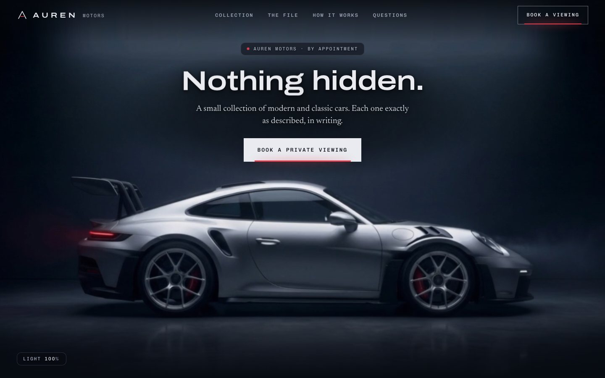
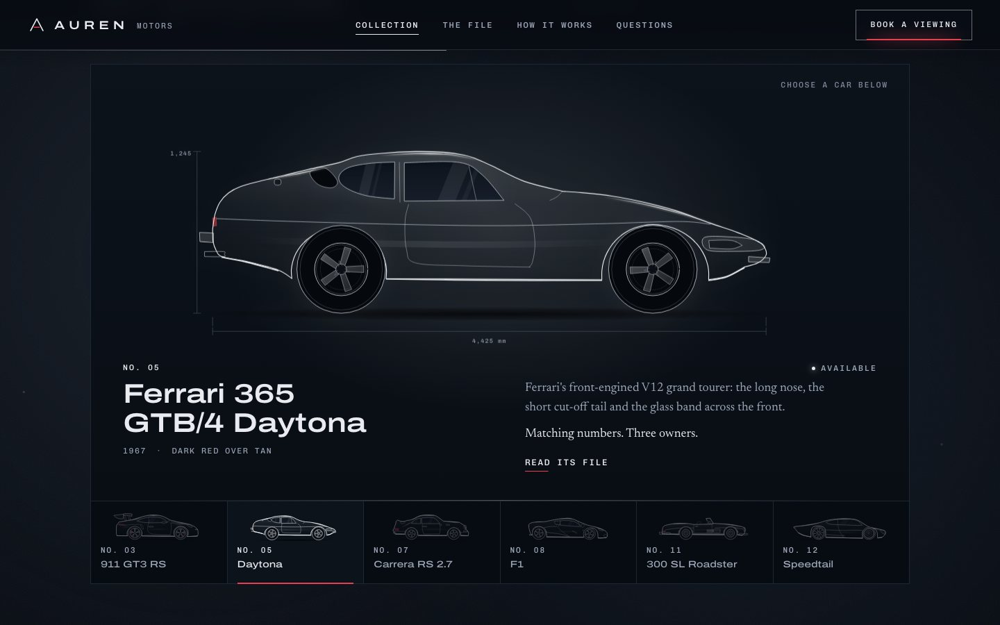
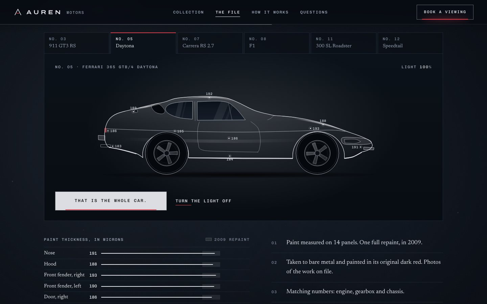
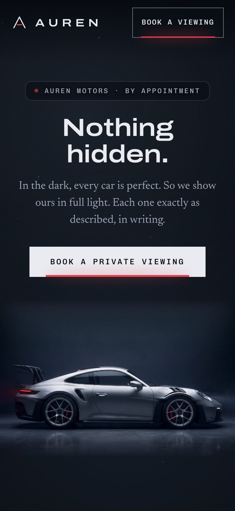

# AUREN Motors

A single-page website for **AUREN Motors**, a fictional boutique that keeps a small collection of modern and classic cars and sells them by private appointment. The brand, its listings and its clients are invented. This is a design and front-end concept.

**Live site:** https://sarpantinerain.github.io/auren-motors/



## The idea

In the dark, every car is perfect. AUREN promises the opposite of flattering light: every car is shown in full light, with its whole history, its paint measured panel by panel and every known repair, in writing. The brand line is **Nothing hidden.**

The site tells that story with light:

- The page opens almost dark, with one thin line of light along the roof of a Porsche 911 GT3 RS. As the visitor scrolls, the light pours down the body until the car stands fully lit.
- In **The File**, the visitor holds a button and an inspection light sweeps the car from nose to tail while its paint readings come up panel by panel.

## Design direction

- **A private gallery at night.** Night ink and graphite surfaces, pearl light for text, and one accent: tail-light red, kept for the call-to-action light bar, focus rings, the "By appointment" dot and the one refinished panel in a file.
- **Three typefaces.** Archivo in its wide cut for headlines, like a modern car badge. Newsreader for text, like an auction catalogue entry. Chivo Mono for small technical labels, like a stamped chassis plate.
- **Motion that follows reading.** Headings rise word by word out of masked lines, rules draw themselves across, and each section arrives as it reaches the screen. Nothing hides again on the way back up.

## Features

- **Scroll-driven opening film.** A four-second film scrubs with the scroll in three captioned stages, with a light readout that counts up to 100%. Phones, portrait tablets, short screens and visitors who prefer reduced motion get a composed still instead.
- **The Collection.** Six cars drawn as technical side elevations in inline SVG, all at one shared scale. Choosing a car draws it in, line by line, and brings up its details.
- **The File.** Every car has its own inspection file: history, paint readings and notes. Hold the button to sweep the light, or choose "Or show it at once". Choosing a car in the Collection opens the same car's file.
- **How it works, client quotes, questions and a booking form.** The form is part of the concept: nothing is sent anywhere, and its confirmation message says so.
- **Scroll choreography** built on IntersectionObserver and requestAnimationFrame. Only transform, opacity and clip-path move, so the layout never shifts.





## Accessibility and resilience

- `prefers-reduced-motion` is respected, and changing it while the page is open takes effect at once.
- A skip link, visible focus styles, and keyboard focus that brings anything still waiting to animate into place at once.
- Screen readers hear each animated heading once, as plain text.
- Without JavaScript the page still shows everything: the still opening, the complete drawings, every reading and every answer.
- No horizontal scrolling on phones, tablets or desktops.



## Built with

- HTML, CSS and vanilla JavaScript in one `index.html`, with no framework, no build step and no dependencies.
- Inline SVG for the car drawings, the route line and the brand mark.
- Browser APIs: IntersectionObserver, ResizeObserver, requestAnimationFrame, matchMedia, and Fetch with a Blob for the film.
- Google Fonts: Archivo, Newsreader and Chivo Mono.
- ffmpeg, to encode the film with short keyframe intervals for smooth scrubbing and to export the stills.
- AI image and video generation for the film and the photographs.

## Run it locally

Browsers block `fetch` for pages opened straight from disk, so a double-clicked `index.html` shows the still version of the opening. For the full scroll film, serve the folder with any static server, for example:

```bash
python3 -m http.server 8000
```

Then open http://localhost:8000.

## Project structure

```
index.html               markup, styles and scripts for the whole site
assets/hero-scrub.mp4    the opening film, encoded for scrubbing
assets/hero-poster.jpg   its first frame, shown while the film loads
assets/hero-ending.jpg   the fully lit last frame
assets/hero-still-m.jpg  the still opening for phones and tablets
assets/og.jpg            the link preview image
screenshots/             images for this README
```

## Credits and disclaimers

AUREN Motors is a fictional brand, created as a design concept. The listings, clients, quotes and inspection data are invented. The film and photographs are AI generated, and the car drawings are illustrations.

Porsche, 911, Ferrari, Daytona, McLaren, Speedtail and Mercedes-Benz are trademarks of their owners. AUREN Motors is not affiliated with or endorsed by any of them.
